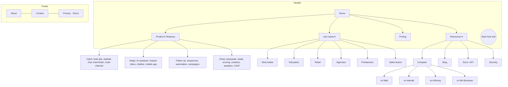

# Wazelo Website: Site Architecture Plan

**Date:** 2026-11-20 · **Site:** wazelo.in (`website-app/`, Next.js) · **Type:** SaaS marketing + docs, blog to come
**Built from:** `.agents/product-marketing.md`, current `Navbar.tsx`, `Footer.tsx`, `sitemap.ts`, and the routes under `src/app/`.

---

## 1. Current state (audit)

27 indexed pages: home, 19 feature pages, use cases, about, security, docs, API reference, contact, privacy, terms.

| # | Problem | Why it matters |
|---|---------|----------------|
| 1 | **No `/pricing` page.** Pricing exists only as the `/#pricing` homepage section | Can't rank for "whatsapp crm pricing" / "wati pricing alternative"; can't link or run ads to it; pricing is a top-3 page on any SaaS site |
| 2 | **No `/features` index.** `/features/*` pages exist but `/features` itself 404s; header "Features" jumps to a homepage anchor | Dead parent URL; no hub page to pass link equity to the 19 feature pages |
| 3 | **Features are a flat list of 19** (footer lists 12, the other 7 only reachable from the homepage list and cross-links) | Visitors can't tell which features matter; nothing ties features to the buyer's job (catch → reply → follow up → close) |
| 4 | **Use cases don't match the ICP.** `/use-cases` is one page with E-commerce, Real estate, Healthcare, Education, Travel, Finance. The About page and the positioning name realtors, coaching institutes, boutiques, agencies and freelancers | Agencies and freelancers (the Solo plan) have no landing page; one long page can't rank for "WhatsApp CRM for real estate" |
| 5 | **No comparison pages.** The FAQ answers "How is Wazelo different from Interakt, Wati or AiSensy?" but no page exists | "X alternative" / "X vs Y" searches are the highest-intent organic traffic for this category |
| 6 | **No blog / resources hub** | No way to capture top-of-funnel search (handled later by `content-strategy`) |
| 7 | **Header nav is 3 anchors + 2 pages** (How it works, Features, Pricing → homepage anchors) | From any inner page, 3 of 5 nav items bounce the visitor back to the homepage |

What's already good: clean `/features/{name}` URLs, breadcrumb JSON-LD on feature pages, a single SEO helper (`lib/seo.ts`), and an honest sitemap.

---

## 2. Proposed page hierarchy

New pages marked ★. **No existing URL changes**, so no redirects are needed. `/#pricing` and `/#features` stay as homepage sections.

```
Homepage (/)
├── Product ★ (/features)                        ← new hub, grouped by job
│   ├── Catch every lead
│   │   ├── Lead ads (/features/lead-ads)
│   │   ├── Website chat (/features/website-chat)
│   │   ├── Lead finder (/features/lead-finder)
│   │   └── Multi-channel inbox (/features/multi-channel)
│   ├── Reply in seconds
│   │   ├── AI assistant (/features/ai-assistant)
│   │   ├── Shared inbox (/features/shared-inbox)
│   │   ├── Chatbot builder (/features/chatbot)
│   │   └── Mobile app (/features/mobile-app)
│   ├── Follow up until they buy
│   │   ├── Sequences (/features/sequences)
│   │   ├── Automation (/features/automation)
│   │   └── Campaigns (/features/campaigns)
│   ├── Close and track
│   │   ├── Proposals (/features/proposals)
│   │   ├── Deals pipeline (/features/deals)
│   │   ├── Lead scoring (/features/lead-scoring)
│   │   ├── Contacts (/features/contacts)
│   │   ├── Analytics (/features/analytics)
│   │   └── CSAT surveys (/features/csat)
│   └── Developers: API & MCP (/features/developer-api)
├── Use cases (/use-cases)                       ← becomes a hub
│   ├── Real estate ★ (/use-cases/real-estate)
│   ├── Coaching & education ★ (/use-cases/education)
│   ├── Shops & D2C ★ (/use-cases/retail)
│   ├── Agencies ★ (/use-cases/agencies)
│   ├── Freelancers ★ (/use-cases/freelancers)
│   └── Sales teams ★ (/use-cases/sales-teams)
├── Pricing ★ (/pricing)
├── Compare ★ (/compare)
│   ├── Wazelo vs Wati ★ (/compare/wati)
│   ├── Wazelo vs Interakt ★ (/compare/interakt)
│   ├── Wazelo vs AiSensy ★ (/compare/aisensy)
│   └── vs WhatsApp Business app ★ (/compare/whatsapp-business-app)
├── Resources
│   ├── Blog ★ (/blog)  · later, planned with content-strategy
│   ├── Docs (/docs)
│   ├── API reference (/api-reference)
│   └── Security (/security)
├── About (/about)
├── Contact (/contact)
├── Privacy (/privacy)
└── Terms (/terms)
```

Depth: every page is ≤2 clicks from home (L1 hub → L2 page). The 19 feature URLs stay flat at `/features/{name}`. The four job groups are sections on the hub page and in the menu, **not** URL levels.

On healthcare, travel and finance: they stay as sections on the `/use-cases` hub. They only get their own pages if they show up in real signups.

---

## 3. Visual sitemap



---

## 4. URL map

| Page | URL | Parent | Nav location | Priority |
|------|-----|--------|--------------|----------|
| Homepage | `/` | — | Logo | High |
| Pricing ★ | `/pricing` | Home | Header | **High** |
| Product hub ★ | `/features` | Home | Header (dropdown root) | **High** |
| 19 feature pages | `/features/{name}` | Product | Header dropdown + footer | Medium (lead-ads, ai-assistant, shared-inbox, sequences, campaigns = High) |
| Use cases hub | `/use-cases` | Home | Header (dropdown root) | Medium |
| Industry pages ★ | `/use-cases/{industry}` | Use cases | Header dropdown + footer | Medium |
| Compare hub ★ | `/compare` | Home | Resources dropdown + footer | Medium |
| Comparison pages ★ | `/compare/{competitor}` | Compare | Footer, FAQ, pricing page | **High** (intent) |
| Blog ★ | `/blog`, `/blog/{slug}` | Home | Resources dropdown + footer | Later |
| Docs | `/docs` | Home | Resources dropdown + footer | Low |
| API reference | `/api-reference` | Home | Resources dropdown + footer | Low |
| Security | `/security` | Home | Resources dropdown + footer | Low |
| About | `/about` | Home | Footer | Low |
| Contact | `/contact` | Home | Footer + Enterprise CTA | Low |
| Privacy / Terms | `/privacy`, `/terms` | Home | Footer | Low |

URL rules: lowercase, hyphens, no trailing slash, no dates in blog slugs, and the competitor name alone after `/compare/`.

---

## 5. Navigation spec

### Header (desktop): 4 items + sign in + CTA
| Order | Item | Behaviour |
|-------|------|-----------|
| 1 | **Product ▾** | Mega menu, 4 columns = the 4 jobs (Catch · Reply · Follow up · Close), ~4 links each + "All features →" to `/features` |
| 2 | **Use cases ▾** | 6 industries/roles + "All use cases →" |
| 3 | **Pricing** | `/pricing` (real page, not an anchor) |
| 4 | **Resources ▾** | Compare, Blog, Docs, API reference, Security |
| right | Sign in · **Start free trial** | Unchanged |

What gets removed: "How it works" (already the hero's second button) and "About" (moves to the footer). Header links go to real pages, so they work the same from any page.

**Mobile:** the same 4 items as accordions. The "Start free trial" and "Sign in" buttons stay pinned at the bottom of the menu, as they are now.

### Footer: 4 columns
- **Product:** All features, Lead ads, AI assistant, Website chat, Shared inbox, Sequences, Campaigns, Proposals, Mobile app, Pricing
- **Use cases:** Real estate, Education, Retail & D2C, Agencies, Freelancers, Sales teams
- **Compare & resources:** vs Wati, vs Interakt, vs AiSensy, vs WhatsApp Business, Blog, Docs, API & MCP, Security
- **Company:** About, Contact, Privacy, Terms

### Breadcrumbs
- Feature pages currently emit `Home > {Feature}`. Change that to `Home > Product > {Feature}` once `/features` exists, so the parent link resolves.
- Use the same pattern for `Home > Use cases > {Industry}` and `Home > Compare > {Competitor}`.
- Breadcrumbs should be visible on L2 pages, not only in the JSON-LD.

---

## 6. Internal linking plan

**Hubs and spokes**
| Hub | Spokes | Rule |
|-----|--------|------|
| `/features` | 19 feature pages | Every feature page links back to the hub and to its 2–3 group siblings |
| `/use-cases` | 6 industry pages | Each industry page links to the 3–4 features that industry uses most |
| `/compare` | 4 comparison pages | Each comparison links to `/pricing` and to the features that make the difference (sequences, AI assistant, lead ads) |
| `/pricing` | — | Links to `/compare/*`, the FAQ, and the top 5 features |

**Cross-section links to add**
- Homepage FAQ "different from Interakt, Wati or AiSensy?" → `/compare`
- Homepage pricing section → "See full pricing" → `/pricing`
- Feature pages → the relevant use case (lead-ads → real-estate & agencies; lead-finder & proposals → freelancers; deals & lead-scoring → sales-teams)
- Industry pages → `/pricing` (Solo for freelancers, Growth for teams)
- About "For people who sell on WhatsApp" photo cards → the matching industry pages

**Orphans:** none today. The 7 feature pages missing from the footer are still linked from the homepage feature list. After the change, every page is linked from its hub, the menu or the footer.

**Sitemap:** add each new route to `src/app/sitemap.ts` with its real `lastModified` date.

---

## 7. Build order

| Step | What | Why first |
|------|------|-----------|
| 1 | `/pricing` page + header link | Biggest gap; simple, since the pricing component already exists |
| 2 | `/features` hub + Product mega menu + breadcrumb fix | Fixes the dead parent URL; groups 19 features by job |
| 3 | `/compare/wati`, `/compare/interakt`, `/compare/aisensy` + `/compare` hub | Highest-intent search; the FAQ already makes the claim |
| 4 | `/use-cases/*`: agencies, freelancers, real estate first | Agencies and freelancers have no page today; real estate is the strongest vertical |
| 5 | Footer rework | After the pages exist |
| 6 | `/blog` | Plan topics with `content-strategy` first |

Each new page gets its copy from `copywriting`, then a `cro` pass, then `ai-seo`.
